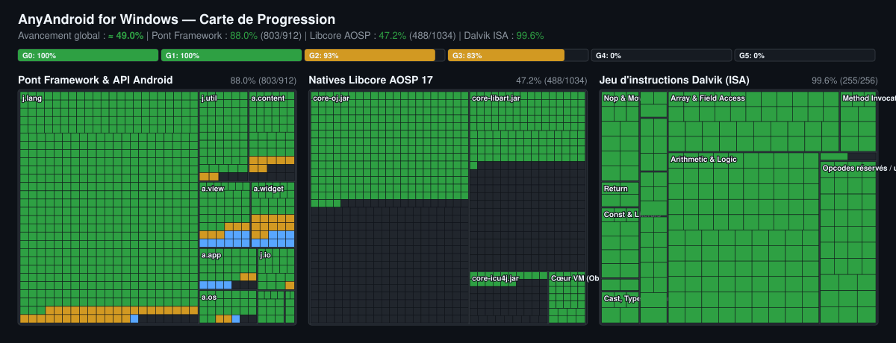

# État du projet AnyAndroid for Windows

*Mis à jour le 23 octobre 2026.*

## Le but final

**Faire tourner Android nativement sur Windows.** Une application Android (APK) doit s'ouvrir comme
un programme Windows ordinaire, dans sa propre fenêtre, sans machine virtuelle, sans émulateur et
sans noyau Linux invité, Google Play Services compris.

Pour y arriver, AnyAndroid rejoue ce que fait un téléphone :

| Couche d'Android             | Ce qu'en fait AnyAndroid                                                          |
|------------------------------|-----------------------------------------------------------------------------------|
| ART (machine virtuelle Java) | Un interpréteur Dalvik écrit en C++ (`runtime/dex-engine`)                         |
| libcore (`java.*`)           | Le **vrai** code d'AOSP, extrait d'une image système. Ses méthodes natives sont réécrites pour Windows |
| framework (`android.*`)      | Le **vrai** `framework.jar` d'AOSP. Ses méthodes natives (libandroid_runtime) sont réécrites pour Windows |
| Bibliothèques natives (.so)  | À venir (G4) : chargeur ELF, bionic sur Windows                                    |
| Services système (Binder)    | Émulés dans le processus (`Parcel` et `Binder` locaux pour commencer)               |
| Rendu, fenêtres, saisie      | Win32. Le rendu du vrai framework (Skia/HWUI) est à venir                           |
| Google Play Services         | microG d'abord, puis les GApps fournies par l'utilisateur (G5)                      |

Le principe est le même qu'avec Wine : on ne réécrit pas Android, on exécute son propre code et on
remplace uniquement la frontière avec le noyau et le matériel.

## Avancement


> 📊 **Carte de progression du projet** · Données brutes : [progress.json](progress.json)  
> Généré automatiquement par [`tools/progress.py`](../tools/progress.py) à chaque push sur `main`.



Les pourcentages sont des estimations de l'effort réalisé dans chaque étape. Ils ne comptent pas
le nombre de fichiers, et ne montent qu'avec une preuve sur le vrai framework ou la vraie libcore
(test e2e, exécution réelle) : un test unitaire qui simule le framework ne suffit pas.

> **Correction du 23 octobre 2026.** Le 17 octobre, une session parallèle avait porté G2 et G3 à
> 100 % et le total à 65 %, sans exécuter le vrai framework (configuration sans R8 ni image
> système). Ces chiffres ont été ramenés à ce qui est vérifié. Le détail est dans
> [HANDOFF.md §13](HANDOFF.md#13-leçons-des-sessions-précédentes-à-ne-pas-reproduire).

| Étape | Contenu                                                    | Avancement | État |
|-------|------------------------------------------------------------|-----------:|------|
| G0    | Mesure des écarts (`gaps`) sur de vrais APK                 | 100 %      | Terminé : [GApps d'Android 17](compatibility/gaps-gapps-android17.md) et [microG](compatibility/gaps-microg.md) mesurés |
| G1    | Runtime : interpréteur, threads, GC, réflexion, JNI         | 100 %      | Terminé ([ADR-003](adr/ADR-003-runtime-threads-gc-jni.md)) |
| G2    | Vraie libcore d'AOSP (Android 17)                           | 96 %       | NIO.2 et `FileChannel` sur VFS, `java.util.zip`, condensés conscrypt, mémoire native émulée, références mises en file et `Cleaner` exécutés comme dans ART ([ADR-004](adr/ADR-004-libcore-aosp.md)). Ajouts du 17 octobre vérifiés et corrigés sur la vraie libcore (e2e `host-libcore`) : E/S scatter-gather, POSIX résiduel, `MethodHandle` porté d'ART, réflexion par les vraies classes de libcore, annotations par `AnnotationFactory`, `Proxy`, fuseaux horaires, contrôle d'accès de la réflexion (`VerifyAccess`) ; plus aucune liaison orpheline, `Unsafe` et `OsConstantsHolder` fidèles à ART et bionic. Reste : `invoke-custom`, natives de libcore manquantes (sockets, ICU, `NativeBN`…) |
| G3    | Vrai `framework.jar` et une application AOSP affichée       | 87 %       | **En cours** : plan de l'[ADR-006](adr/ADR-006-demarrage-applications.md). J0-J2, J4, J5 faits ; J6 et J7 faits pour l'application d'exemple (image complète vérifiée au pixel, à 420 dpi depuis le 23 octobre) ; J8 fait (fenêtre Win32, clics et touches jusqu'à `View.onClick`, BACK comme Android 12+, prouvés par des tests e2e) ; J9 fait (navigation entre activités, toasts et dialogues prouvés par des e2e) ; J10 à faire ; J3 en cours |
| G4    | Couche native ELF (bibliothèques `.so` des applications)    | 0 %        | À faire : architecture proposée dans l'[ADR-009](adr/ADR-009-couche-native-elf.md) (chargeur ELF x86_64, bionic, JNI) |
| G5    | Services Google : microG, puis GApps                        | 0 %        | À faire |
| **Total** | **Android natif sur Windows**                          | **≈ 50 %** | Pondéré par l'effort : G0 5 %, G1 10 %, G2 10 %, G3 30 %, G4 25 %, G5 20 % |

```
G0 ██████████ 100 %
G1 ██████████ 100 %
G2 █████████░  96 %
G3 ████████░░  87 %
G4 ░░░░░░░░░░   0 %
G5 ░░░░░░░░░░   0 %
   ───────────────
   █████░░░░░ ≈ 50 % vers « Android natif sur Windows »
```

## Ce qui marche aujourd'hui (vérifié par 48 suites de tests et 197 tests unitaires)

- **Analyse d'APK sans rien exécuter** (`anyandroid inspect`). L'analyse est durcie contre les
  archives piégées et produit un verdict de compatibilité.
- **Applications de démonstration** affichées dans une vraie fenêtre Windows, avec cycle de vie
  Android et bouton Retour.
- **Runtime complet** : vrais threads Windows, ramasse-miettes, réflexion et JNI.
  `InvocationTargetException` garde sa cause, son message et sa pile, même construite par le
  bytecode de la libcore. `exec --profile` liste les méthodes les plus coûteuses (instructions,
  appels) ; sans l'option, les compteurs ne sont pas touchés.
- **Lecture des images système Android** (`anyandroid image`) : formats sparse, super, ext4 et
  EROFS compressé, APEX.
- **Vraie libcore d'Android 17** : collections, `Formatter`, concurrence, fichiers, jeux de
  caractères, `VarHandle`, et **NIO.2 (`sun.nio.fs`, `FileDispatcherImpl`, `FileChannel`) sur VFS**.
  - **Réflexion, `MethodHandle`, annotations et `Proxy` comme dans ART** (e2e `host-libcore`) :
    `Method`, `Constructor`, `Field` et `AccessibleObject` sont les classes de libcore, créées
    avec les champs d'ART et servies par les natives d'ART portées (`Method.invoke`, `Field.get`
    et `set*` avec leurs conversions et leurs messages, signatures génériques, `MethodParameters`).
    `invokeExact` exige le type exact, `invoke` passe par `asType` et les transformateurs Java de
    libcore (`EmulatedStackFrame`). Les annotations sont créées par `AnnotationFactory`
    (valeurs par défaut, `toString`, `equals`), dans l'ordre du fichier DEX. Les classes proxy
    suivent `ClassLinker::CreateProxyClass`. Le contrôle d'accès de la classe appelante suit
    `VerifyAccess` d'ART (membre privé, protégé ou de paquet, classe d'un autre paquet pour
    `Constructor.newInstance`, messages d'ART). Limite : le chargeur de classes d'un proxy est
    ignoré (un seul espace de classes).
  - **POSIX résiduel** : `dup` et `dup2` partagent la description ouverte (position commune),
    `ioctlInt(FIONREAD)`, `fcntlInt`, `umask` ; `readv`/`writev` et les E/S groupées de
    `FileChannel`.
  - **`java.util.zip`** (`Deflater`, `Inflater`, flux GZIP, `CRC32`, `Adler32`) sur
    [miniz](../runtime/third_party/miniz/README.md) intégré, avec le comportement de zlib pour les
    vidages (répétés, ou dans un tampon trop petit) et un nombre plafonné de flux vivants ; les
    flux jamais fermés sont libérés avec leur `Inflater`/`Deflater` par le ramasse-miettes
    (exemple `zip-demo`).
  - **`MessageDigest`** (MD5, SHA-1, SHA-224, SHA-256, SHA-384, SHA-512) par le fournisseur
    `AndroidOpenSSL` de conscrypt, dont les natives de condensé sont réécrites (contextes en
    identifiants bornés). Pas de chiffrement ni de TLS.
  - **Mémoire native émulée** : `Unsafe.allocateMemory` et les accès par adresse,
    `libcore.io.Memory`, `ByteBuffer` directs, `Os.mmap` (anonyme, ou copie privée d'un fichier)
    et `FileChannel.map`. Les adresses sont des valeurs étiquetées vérifiées à chaque accès, jamais
    des pointeurs de l'hôte, dans un budget global de 1 Gio. Une projection en lecture seule n'est
    lue qu'au premier accès, comme les pages d'un vrai `mmap`, et reste valable après la fermeture
    du descripteur. Limite : la libération des projections (`FileChannel.map`, `Os.mmap`) par
    leur `Cleaner`, quand le ramasse-miettes passe, n'a pas encore de test ; `munmap` explicite
    est testé.
  - **Références** : le ramasse-miettes vide les `WeakReference` et `PhantomReference` dont le
    référent n'est plus accessible et les remet à la libcore comme ART (`ReferenceQueue.add`, au
    point de sûreté suivant, jamais pendant la collecte). Le vrai `ReferenceQueueDaemon` les met
    en file et exécute les `sun.misc.Cleaner`, donc aussi les libérations de
    `NativeAllocationRegistry` (exemple `libcore-demo`, section « références »).
  - **Bibliothèques natives** : `System.loadLibrary` réussit sans rien charger (chargeur ELF prévu
    en G4) ; l'absence n'apparaît qu'au premier appel d'une méthode native non fournie
    (`UnsatisfiedLinkError`).
- **Code d'hôte en Java** ([ADR-006](adr/ADR-006-demarrage-applications.md), jalon J0) : `runtime/android-host`
  est compilé par `javac` + D8 en `anyandroid-host.dex` (option active avec un JDK ≥ 17 et
  `-DAA_R8_JAR`), chargé après le chemin d'amorçage. Une méthode abstraite du framework qu'une
  classe d'hôte n'implémente pas répond une valeur neutre et est journalisée, au lieu
  d'`AbstractMethodError` (test `host-probe`).
- **`ServiceManager` local** (jalon J1) : `BinderInternal.getContextObject` et
  `ServiceManagerProxy.getNativeServiceManager` renvoient le gestionnaire de services de l'hôte
  (`aa.host.services.LocalServiceManager`, qui étend `IServiceManager.Stub`) ; le vrai
  `ServiceManager` du framework y enregistre et y retrouve les services, sans `Parcel`.
- **Vrais chargeurs de classes** (jalon J2) : l'APK est servi en lecture seule sous
  `/data/app/<paquet>/base.apk`. Les natives `DexFile` (`openDexFileNative`,
  `defineClassNative`, `getClassNameList`…) font fonctionner les vrais `PathClassLoader` et
  `DexClassLoader` de libcore. Une classe d'application rapporte le chargeur qui l'a définie
  (`getClassLoader`), et `Class.forName` passe par le chargeur demandé. Comme ART, la VM résout
  directement les chargeurs standard, sans une `ClassNotFoundException` par classe. Il n'y a qu'un
  seul espace de classes : une classe déjà définie est partagée entre les chargeurs, et l'espace
  d'amorçage gagne toujours.
- **Services système locaux** (jalon J3, en cours). Le service `package` s'appuie sur le vrai
  `PackageParser` d'Android 17, qui analyse l'APK servi par le VFS. Il fournit `ApplicationInfo`,
  `PackageInfo`, `ActivityInfo` et la résolution des intents (activité de lancement). Le service
  `permissionmgr` est aussi en place. `exec --trace-services` écrit chaque appel du framework à
  un service ; une méthode non implémentée y apparaît, renvoie une valeur neutre et ne bloque
  pas l'exécution (test `host-services`).
- **Expressions régulières** (`runtime/regex`). C'est un moteur compatible ICU, celui
  qu'utilise le `java.util.regex` d'Android : classes avec `&&` et `--`, propriétés
  `\p{…}`, groupes nommés, assertions avant et arrière, quantificateurs possessifs, régions,
  `hitEnd` et `requireEnd`. Il a été validé contre `java.util.regex` sur plus de 200 cas, et
  borne les pas et la pile de retour, puisque les motifs viennent de code non fiable.
- **Natives graphiques du framework** (`framework_*.cpp`), chacune vérifiée contre le jar :
  `RenderNode` et `Paint` comme magasins de propriétés avec les valeurs par défaut de HWUI ;
  `Path` sur le modèle de `SkPath` (contours, rectangles, ovales, rectangles arrondis avec la mise
  à l'échelle des rayons de `SkRRect`) et `Path.approximate` à l'identique de HWUI (les
  interpolateurs d'animation en dépendent) ; `PathParser` (chemins SVG de `VectorDrawable` :
  analyse et messages d'erreur de HWUI, arcs en coniques comme `SkPath::arcTo`, morphing) ;
  `Matrix` avec les formules de `SkMatrix` ; `Canvas` et `BaseCanvas` sur un vrai `SkCanvas`
  du Skia d'Android 17 ([ADR-008](adr/ADR-008-moteur-2d.md)), port de `SkiaCanvas` de HWUI
  (sauvegardes partielles et découpes persistantes, calques, ombres de `setShadowLayer`,
  `PaintFlagsDrawFilter`, formes, chemins, régions, bitmaps avec la mise à l'échelle des
  densités, 9-patchs en treillis, maillages, texte par la mise en page du moteur de texte puis
  des passes de glyphes, soulignés et barrés, texte sur un chemin) ; les effets des `Paint`
  (`BitmapShader`, dégradés, `ComposeShader`, filtres de couleur, de masque, effets de chemin) ;
  `Region` sur le modèle de `SkRegion` (bandes canoniques, opérations booléennes, itération et
  `toString` de Skia) ; l'arbre de `VectorDrawable` (groupes, chemins, valeurs par défaut et
  disposition des propriétés de HWUI, possédé par `VirtualRefBasePtr`) ; `Font`,
  `FontFamily` et `Typeface` avec les règles de style et de repli de minikin. La mesure et le rendu du texte attendent le moteur de texte (J6).
- **Annotations système des DEX** : `getEnclosingClass`, `getDeclaringClass`, `getSimpleName`,
  `isAnonymousClass` et `getDeclaredClasses` sont lus dans les annotations `InnerClass`,
  `EnclosingClass`, `EnclosingMethod` et `MemberClasses`. La casse Unicode
  (`Character.toUpperCase`…) vient des tables du système, et plus de la locale « C » de la
  bibliothèque C, qui ne convertissait que l'ASCII.
- **Système de fichiers virtuel** ([ADR-005](adr/ADR-005-systeme-de-fichiers-virtuel.md)).
  `/system` et `/apex` sont servis depuis l'image, et `/data` et `/sdcard` sont isolés dans un bac
  à sable. Le processus émulé ne voit ni les fichiers ni le nom d'utilisateur de l'hôte.
- **Vrai `framework.jar`** : `Log`, `TextUtils`, `Bundle`, `ArrayMap`, `Uri`, `Base64`, `JSONObject`,
  `Build` (identité honnête « AnyAndroid »), `Looper`/`Handler`, `SystemClock`, `Parcel` (aller-retour
  en octets d'un `Bundle` et d'un `Intent`), `Binder` local (`transact`), `SystemProperties.digestOf`
  (fournisseurs JCA) et `Resources.getSystem()` sur le vrai `framework-res.apk` (thème Material,
  `TypedArray`). L'exemple `framework-demo` les vérifie.
- **Ressources des applications en mode pont** (`anyandroid run`) : le `resources.arsc` de l'APK est
  chargé avec la configuration de l'appareil (langue de Windows ou `--locale`). `Resources`
  (`getString`, `getText`, `getColor`, `getDimension…`, `getInteger`, `getBoolean`, `getIdentifier`,
  `getResourceName`), `Context.getString(id, args…)`, `TextView.setText(int)`, `Activity.setTitle(int)`,
  `Toast.makeText(…, int, …)` et le titre `@string/` du manifeste.
- **Mises en page XML** : `LayoutInflater` gonfle `res/layout` dans les vues du pont
  (`setContentView(R.layout.x)`, `inflate`, `<include>`, `<merge>`, `android:onClick`, attributs
  courants : id, texte, indice, orientation, tailles, couleurs, poids, visibilité, activation).
  L'APK `resources-demo` le vérifie en français et en anglais.
- **Contexte** : `Context.getSystemService()` (seul `layout_inflater` en mode pont).
  `getFilesDir()`, `getCacheDir()` et `getDataDir()` restent non pris en charge : le pont ne
  définit pas `java.io.File` (ils viendront de framework.jar, ADR-002).

## Ce qui est en cours (G3)

**Les ressources Android** (`runtime/resources`). C'est l'équivalent d'AssetManager2 de
libandroidfw : sans lui, aucune application ne peut lire ses textes, ses couleurs, ses thèmes ni
ses mises en page.

- Fait :
  - lecture de `resources.arsc` : pools de chaînes UTF-8/UTF-16 et styles, entrées compactes, types
    creux, bibliothèques partagées ;
  - choix de la meilleure variante selon la configuration : langue avec script, densité, taille
    d'écran, mode nuit… avec les règles exactes d'AOSP ;
  - styles avec héritage, thèmes et résolution d'attributs de `TypedArray` ;
  - XML compilé (mises en page) ;
  - tests unitaires complets en mémoire pour `runtime/resources` (`test_resources.cpp`, 10 tests) ;
  - `apkgen build --res` compile un dossier `res/` (valeurs, mises en page, langues) en
    `resources.arsc` et XML binaire, sans SDK Android ; `--r-txt` donne les identifiants `R` ;
  - implémentation de `sun.nio.fs` sur le VFS (`libcore_nio.cpp`) débloquant les dépendances NIO.
- Vérifié sur le vrai `framework-res.apk` d'Android 17 avec la commande
  `anyandroid resources <apk> --get string/cancel --locale fr-FR` (résultat : « Annuler »), et
  par le vrai framework : la section `resources` de `framework-demo` passe par
  `Resources.getSystem()`, un thème et un `TypedArray`.
- Les natives Java correspondantes sont écrites : `AssetManager`, `ApkAssets`, `StringBlock` et
  `XmlBlock`, plus de 90 méthodes.
- En mode pont, `Context`, `Activity`, `TextView`, `Toast` et `LayoutInflater` sont branchés sur
  les ressources de l'APK (`android_res.cpp`).

## Reprise : où en est le travail (2026-10-16)

Un agent qui reprend le développement seul part de [HANDOFF.md](HANDOFF.md) : environnement,
outils, conventions, état, prochaines étapes et règles.

**Jalon J4 atteint : démarrage direct d'une application** (ADR-006). Le test e2e `launch` passe :
sur le vrai code d'Android 17, l'`Application` puis `MainActivity` vont jusqu'à `onCreate`,
`onStart`, `onResume` et « activité au premier plan ». Le lanceur Java d'hôte
`aa.host.Launcher` (`runtime/android-host/java/aa/host/Launcher.java`) reproduit
`ActivityThread.attach`, le début de `handleBindApplication` et le démarrage à la Robolectric. Pour
le relancer (ou `tools/dev/launch.sh`) :

```
anyandroid exec --bootclasspath <libcore17> --system-image <system.img> --trace-services \
    build/samples/basic-activity.apk aa.host.Launcher com.anyandroid.samples.basic
```

Ce qui passe, avec le vrai code d'Android 17 :
- `ActivityThread`, `Instrumentation`, le `ServiceManager` local et les services `package`,
  `permissionmgr`, `window`, `display`, `input_method`, `accessibility`, `activity_task`
  (`getActivityClientController`, `setTaskDescription`) et `activity` (`getContentProvider`) ;
  le fournisseur `settings` est un vrai `ContentProvider` du framework côté hôte
  (`SettingsProvider` : `Settings.Global`, `Secure`, `System` et les drapeaux de `DeviceConfig`
  persistés dans `/data/system`, protocole `call` de la plateforme ; `ANDROID_ID` est un
  tirage aléatoire de 64 bits fait au premier usage et conservé, jamais dérivé de l'hôte).
  Les seules méthodes encore « (non implémentée) » de la trace de `launch` sont
  `DisplayService.getOverlaySupport` (valeur neutre) ;
- les méthodes d'expressions régulières de `String` (`matches`, `replaceAll`, `replaceFirst`,
  `split` sur une vraie expression) passent par `java.util.regex` en mode libcore. `ServicesProbe` vérifie que chaque méthode
  publique de ces services surcharge bien une méthode de l'interface du vrai framework (une
  déclaration de `stubs/` décalée compilait sans jamais être appelée) ;
- `Typeface.loadPreinstalledSystemFontMap()` : `fonts.xml` est lu, les 208 polices de
  `/system/fonts` sont projetées (lues seulement au premier accès) et les `Font`, `FontFamily` et
  `Typeface` de minikin construits ;
- `LoadedApk`, le vrai `PathClassLoader` de l'APK, l'`Application`, `ContextImpl`,
  `Activity.attach` et sa `PhoneWindow` ;
- `MainActivity.onCreate` construit ses vues (`TextView` avec `Paint` et `Typeface`, fonds
  `RippleDrawable`/`GradientDrawable` avec `Path`) puis appelle `setContentView` : `DecorView`
  est créée, ses interpolateurs d'animation (`Path.approximate`) aussi, et la mise en page du
  décor est gonflée (`Toolbar` et ses `ImageView`, avec `Matrix`) ; l'icône par défaut
  (`AdaptiveIconDrawable` et ses `VectorDrawable`) passe par `PathParser`, `Canvas`, `Region` et
  l'arbre de `VectorDrawable` ;
- `onStart`, puis `onResume` : `AutofillManager` lit `DeviceConfig` par le fournisseur `settings`,
  et `EventLog` tient ses événements dans le journal de débogage.

- **Sous-système d'images opérationnel** :
  - Décodeur PNG (miniz zlib, unfiltering Paeth/Sub/Up/Average, conversion ARGB_8888) ;
  - Parsing et injection des chunks 9-patch AOSP (`npTc`, optical insets `npLb`, outlines `npOl`) ;
  - Natives Java d'`android.graphics.NinePatch` (`isNinePatchChunk`, `validateNinePatchChunk`, `nativeFinalize`) ;
  - Natives Java d'`android.graphics.Bitmap` (`nativeCreate`, `nativeGetPixel`, `nativeSetPixel`, `nativeRowBytes`, `nativeErase`, `nativeCopy`, `nativeSameAs`, cycle de vie et allocation) ;
  - Natives Java d'`android.graphics.ImageDecoder` (`nCreate` sur assets décompressés d'APK, flux et mémoire, `nDecodeBitmap`, `nGetSampledSize`).

**J5 en cours : démarrage par les vrais gestionnaires.** `aa.host.ProcessLauncher` lance
`ActivityThread.main` ; `attach` appelle `IActivityManager.attachApplication`, le lanceur répond
par `bindApplication` (avec les arguments de `system_server` pour une application ordinaire) puis
par une `ClientTransaction` (`LaunchActivityItem`, `ResumeActivityItem`). Sur la vraie boucle
principale, `handleBindApplication` crée l'`Application`, puis `TransactionExecutor` exécute
`handleLaunchActivity` et `handleResumeActivity` : `onCreate`, `onStart`, `onResume`. Ensuite
`WindowManager.addView` → `ViewRootImpl` → `IWindowSession.addToDisplayAsUser` ouvre la fenêtre
logique (cadres 1080×1920, inset, configuration fusionnée, paire d'`InputChannel`),
`activityResumed` est reçu, le vsync à 60 Hz (`DisplayEventReceiver`, minuteurs de la file native
servis par `nativePollOnce`) déclenche `performTraversals`. La hiérarchie entière se mesure, texte
compris (`BoringLayout` et `StaticLayout`). `relayoutWindow` crée la surface côté application
(Android 17 la crée hors de l'arbre des couches, `NOT_ADD_TO_ROOT`, et la confie au gestionnaire
de fenêtres, qui la rattache sous la couche de la fenêtre : voir J9), `IWindowSession.relayout`
renvoie les cadres avec une `WindowConfiguration` plein écran, puis `BLASTBufferQueue` fournit la
`Surface`. La mise en page se fait à la taille et à la densité de l'écran (420 dpi : la
configuration globale est calculée comme `DisplayContent.computeScreenConfiguration`, avec
`ro.sf.lcd_density`) et `drawSoftware` verrouille la surface : **la fenêtre est dessinée**
par le Skia d'AOSP dans le tampon de la `Surface` (fond de `DecorView`, barre d'action avec son
titre, les deux `TextView` de l'activité, bouton Material avec son ombre et son texte), l'image
est publiée (`unlockCanvasAndPost`), la synchronisation de `SurfaceSyncGroup` se termine et
l'activité passe au premier plan. Comme zygote (`preloadCompatConfig`), `ProcessLauncher`
précharge les règles de compatibilité de `/system/etc/compatconfig` : chaque changement suit la
version cible de l'application (sans elles, tous étaient actifs, dont `ENFORCE_EDGE_TO_EDGE`
qui plaçait le contenu sous la barre d'action pour une application ciblant l'API 34).
`exec --frame-out <fichier.png>` écrit chaque image publiée ; le test e2e `process-launch`
vérifie ce démarrage et l'image de 1080×1920 qu'il produit, avec des sondes de pixels lues par
`anyandroid image probe` (barre d'action et titre, lettres des deux `TextView`, bouton, fond).

**J6 atteint : moteur de texte et shaping complets.** Android mesure et met en forme le texte avec minikin, sur HarfBuzz (mise en
forme) et sur FreeType via Skia (métriques et avances, avec l'indication `FT_LOAD_TARGET_NORMAL`
sans auto-hinter). AnyAndroid reprend les mêmes composants, aux versions d'AOSP : FreeType 2.13.2
(miroir AOSP, configuration d'Android) et HarfBuzz 10.2.0, réduits aux fichiers utiles dans
`runtime/third_party` ([ADR-007](adr/ADR-007-moteur-de-texte.md)). La logique de minikin (choix de la police par couverture, mise en forme par
mots, espacements) et celle du scaler FreeType de Skia sont réécrites d'après le code d'AOSP. Sont pleinement branchés :
- les natives de mesure de `Paint`, ainsi que `MeasuredText` et `LineBreaker` : coupure gloutonne et optimale de minikin, frontières de lignes de l'ICU4J de la libcore, césure aux traits d'union et tirets conditionnels ;
- `TextRunShaper` et `PositionedGlyphs` (`nativeShapeTextRun` pour `char[]` et `String`, tranche de contexte, direction LTR et RTL, et l'ensemble des 14 getters et libération de `PositionedGlyphs` avec les poignées `Font` de minikin/HWUI dans la table `0x1129`). Les motifs de césure `.hyb` attendent `Hyphenator.init`.

**J7 atteint : moteur 2D logiciel complet sur le Skia d'Android.** Les natives de dessin reprennent `SkiaCanvas` de HWUI
sur un `SkCanvas` posé sur les pixels des bitmaps et des tampons de fenêtre (RGBA prémultiplié,
l'ordre d'Android) ; les polices du moteur de texte deviennent des `SkTypeface` FreeType comme
dans `MinikinFontSkia` ([ADR-008](adr/ADR-008-moteur-2d.md)). Ajoutés le 17 octobre, couverts par des tests unitaires mais pas encore exercés par une vraie
application :
- `RenderNode` avec calcul exact de la matrice 2D affine et des rotations 3D par caméra `Sk3DView` (`rotationX`, `rotationY`, `rotationZ`, `camera_distance`) pour `nGetTransformMatrix` et `nGetInverseTransformMatrix` ;
- tracé direct de glyphes `BaseCanvas.nDrawGlyphs` avec `SkTextBlob` et `SkTypeface` ;
- AGSL complet : `RuntimeShader` et `RuntimeColorFilter` avec compilation de shaders personnalisés, mise à jour des variables d'uniforme (scalaires, vecteurs, tableaux, couleurs, entiers) et liaison des enfants shaders et filtres de couleur.

**J8 fait : l'écran dans une fenêtre Win32, et les entrées jusqu'au vrai framework.** `exec
--window` montre les images publiées par le vrai framework dans une fenêtre Win32 (mise à
l'échelle avec les proportions de l'écran, sur son propre fil) ; la fermer termine le processus.
La souris et le clavier de la fenêtre atteignent l'application comme sur un téléphone :
- un **répartiteur d'entrées** (`input_dispatcher.cpp`) reproduit InputDispatcher : les fils de
  l'hôte déposent les événements dans une file protégée ; un fil répartiteur, qui ne prend le
  verrou global que le temps de les remettre, choisit la fenêtre comme InputDispatcher (le toucher
  à la fenêtre visible et touchable la plus haute sous le point, une fenêtre de toast
  `NOT_TOUCHABLE` ne volant jamais un clic ; les touches et le texte à la fenêtre qui a le focus)
  et les publie sur le canal de la fenêtre, avec sa transformation. La liste des fenêtres vient du
  service `window` de l'hôte (`InputWindows`, ordre z des types de fenêtres d'Android) ;
- le `Looper` de la fenêtre lit son canal comme `NativeInputEventReceiver` : vrais `MotionEvent`
  et `KeyEvent`, `InputEventReceiver.dispatchInputEvent` (statique dans Android 17), mouvements
  regroupés jusqu'à l'image suivante, fin des événements (`finishInputEvent`) rapportée ;
- `FrameWindow` : bouton gauche = doigt (capture, conversion par le cadre de l'image, appuis dans
  les bandes ignorés), molette = `ACTION_SCROLL`, touches spéciales (Entrée, Retour arrière,
  Échap = BACK, flèches…), caractères tapés (`WM_CHAR`, toute disposition de clavier) convertis en
  frappes du `Virtual.kcm` de l'image ou en `ACTION_MULTIPLE` ;
- `exec --input "<étapes>"` (appuis, touches, texte, attentes d'images et de stabilisation) et
  `--trace-input` rendent les tests déterministes.

Preuves : `e2e-process-input` (deux clics sur le bouton de l'exemple : `View.onClick` du vrai
framework, le libellé devient « Clics : 2 », sondes de pixels), `e2e-process-back` (BACK sur
l'activité racine, lancée depuis l'écran d'accueil : comme Android 12+, la tâche passe en
arrière-plan, `onPause` et `onStop` sans `onDestroy` ; sans écran d'accueil à montrer, le
processus se termine), chaque test lancé trois fois à
l'identique ; et deux vrais clics de souris dans la fenêtre Win32 (sous Xvfb) donnent la même
image. Le clic joue un son (`View.playSoundEffect`) : le service `audio` répond comme
`AudioService`, sans sortie audio.

**J9 fait : navigation, toasts et dialogues, fenêtres composées comme sur un téléphone.**
- Le service `notification` de l'hôte (`NotificationService`) reprend la file de
  NotificationManagerService : un toast à la fois, au plus 5 par paquet, 2 s (`LENGTH_SHORT`) ou
  3,5 s (`LENGTH_LONG`), 333 ms de plus pour un toast texte et 250 ms de plus après un toast
  texte. Un toast texte est montré comme le fait `ToastUI` de SystemUI, avec le `ToastPresenter`
  du framework et sa vue `transient_notification`, dans le processus de l'application (la mise en
  page de SystemUI, avec l'icône de l'application, n'est pas chargée) ; un toast personnalisé
  passe par le `Toast.TN` de l'application, comme sur un téléphone.
- Android 17 crée la surface d'une fenêtre côté application (`ViewRootImpl.createSurfaceControl`,
  hors de l'arbre des couches) et la confie à `relayout`. `WindowService` fait comme WMS :
  cadres calculés par le vrai `WindowLayout.computeFrames` du framework (comme
  `DisplayPolicy.layoutWindowLw`), une couche par fenêtre (`WindowState`) sous laquelle la surface
  de l'application est rattachée (`setClientSurface`), placée au cadre, ordonnée par la politique
  d'Android 17 (`getWindowLayerFromTypeLw`), et un voile noir d'alpha `dimAmount` sous une
  fenêtre `FLAG_DIM_BEHIND`, comme `Dimmer` (sans fondu).
- Le pont compose l'arbre des couches comme SurfaceFlinger (parents, positions, alpha, z relatif,
  couches hors de l'arbre, couches de couleur) et présente une image quand un tampon est posté ou
  qu'une transaction change ce qui s'affiche. Non faits : découpes, matrices, coins arrondis,
  ombres (le rendu est logiciel, comme un Android sans accélération), flou.

Preuves : `e2e-process-toast` (le troisième clic montre « Trois clics ! » centré à 48 dp du bas,
au-dessus de l'activité, sondes sur le « T ») et `e2e-process-toast-end` (le toast disparaît après
2 333 ms : sa fenêtre et sa couche sont retirées, l'activité reste seule), chacun lancé trois fois à
l'identique ; test unitaire `surface_compositor_walks_the_layer_tree`.

**Navigation entre activités vérifiée** (pile du service `activity_task` de l'hôte, poussée le
17 octobre, corrigée le 23) : `startActivity` avec un extra, `onPause` de l'activité courante,
`onCreate`/`onStart`/`onResume` de la nouvelle puis `onStop` de la précédente ; retour par
`finish()` ou par BACK : `onPause`, `onStart`/`onResume` de l'activité précédente, `onStop` et
`onDestroy` de celle qui finit, dans l'ordre d'Android. BACK sur l'activité racine suit
`ActivityClientController.shouldMoveTaskToBack` ; une activité introuvable donne
`START_CLASS_NOT_FOUND` ou `START_INTENT_NOT_RESOLVED` (donc `ActivityNotFoundException`).
Preuves : `e2e-process-nav` (l'écran de détail et son message) et `e2e-process-nav-back` (retour
par le bouton puis par BACK, l'écran principal revient), sur l'exemple `two-screens`, chacun lancé
trois fois. Non faits : une seule tâche, sans modes de lancement ni drapeaux d'intention
(`singleTop`, `CLEAR_TOP`…), sans `startActivityForResult`.

**Dialogues vérifiés** : un `AlertDialog` du framework (mise en page Material
`alert_dialog_material`, coins arrondis, titre, message, boutons) s'ouvre dans sa propre fenêtre,
centrée par le `WindowLayout` du framework, avec le voile de `Dimmer` sous elle (alpha 0,6, le
`backgroundDimAmount` du thème : la fenêtre derrière est à 40 %). « OUI » appelle le
`DialogInterface.OnClickListener` de l'activité et ferme le dialogue ; BACK va au dialogue, qui a
le focus, et l'annule (`Dialog.onKeyUp`) ; le focus revient ensuite à l'activité. La `ScrollView`
du dialogue a demandé les natives de `android.graphics.Interpolator` (fondu des barres de
défilement), portées de `SkiaInterpolator` de HWUI. Preuves : `e2e-process-dialog` (sondes sur le
voile, la surface du dialogue, son titre et « OUI »), `e2e-process-dialog-answer` (« Réponse :
oui », plus de voile), `e2e-process-dialog-back` (annulation, puis BACK atteint l'activité), sur
l'exemple `dialog-demo`, chacun lancé trois fois ; test unitaire
`graphics_interpolator_follows_skia_interpolator`. Pas encore vérifiés : `PopupWindow` (menus
déroulants, sous-fenêtres) et les changements de configuration (rotation, recréation).

**À savoir pour la suite** :
- dans le bac à sable `/data`, `unlink` et `rename` d'un fichier ouvert suivent Linux (nom libéré
  ou remplacé tout de suite) : sémantique POSIX de NTFS, avec un repli par répertoire caché quand
  elle manque (wine 9 n'a pas `FileDispositionInfoEx`/`FileRenameInfoEx` : sous wine, c'est le
  repli qui est testé ; le chemin POSIX l'est par la CI Windows) ;
- toutes les lectures de temps passent par `runtime/common/clock.h` : une seule horloge monotone
  pour `System.nanoTime`, `SystemClock` et les échéances des attentes. Sur Windows, une attente
  temporisée finit sur un tick d'environ 15,6 ms, et la demande de `timeBeginPeriod(1)` peut être
  ignorée (la CI Windows mesurait 14 ms par attente de 1 ms) : la fin de chaque attente se fait
  donc par pas de 1 ms sur un minuteur haute résolution (`CREATE_WAITABLE_TIMER_HIGH_RESOLUTION`),
  verrou relâché. Vérifié par `threads_timed_waits_are_precise`, qui tourne aussi sur le Windows
  réel de la CI ;
- le lanceur direct `aa.host.Launcher` (J4) n'installe pas `AppCompatCallbacks` comme
  `handleBindApplication` : tous les changements de compatibilité y restent actifs, quelle que
  soit la version cible (`ProcessLauncher`, J5, suit les règles préchargées) ;
- les règles préchargées ne couvrent que `/system/etc/compatconfig` et
  `/system/system_ext/etc/compatconfig`, comme celles de zygote. Les changements déclarés par les
  modules APEX (par exemple ceux de la libcore dans `com.android.art`) ne sont pas lus : le
  `system_server` d'Android les enverrait désactivés à `bindApplication` selon la version cible,
  ici ils restent actifs ;
- la trace `--trace-services` ne liste que les appels du framework aux objets `Binder` de
  l'hôte ; une méthode non implémentée y apparaît avec « (non implémentée) » et renvoie une
  valeur neutre ;
- le message `ERROR_PACKAGE_NOT_FOUND: com.android.scheduling.flags` vient du stockage aconfig :
  seuls les conteneurs `system`, `system_ext` et `product` sont montés. Ceux des APEX restent à
  servir sous `/metadata/aconfig` ;
- parmi les démons de la libcore, seul le `ReferenceQueueDaemon` est lancé (à la première
  collecte qui libère des références) : sans `FinalizerDaemon`, les méthodes `finalize()` ne
  sont jamais appelées, et les `SoftReference` sont gardées tant qu'il n'y a pas de notion de
  pression mémoire ;
- la casse Unicode suit les tables du système ; le signe Kelvin (U+212A) ne se replie pas sur `k`.

## Problèmes connus

- **Densité (corrigé le 23 octobre)** : jusque-là, la configuration donnée à l'application
  n'avait pas de `densityDpi` : tout était mis en page à 160 dpi (barre d'action de 56 pixels au
  lieu de 147) alors que l'écran annonce 420 dpi. Les images vérifiées au pixel avant cette date
  l'étaient à cette densité ; les sondes des e2e ont été refaites à 420 dpi.
- **CI Windows** : depuis le 23 octobre, toutes les exécutions GitHub Actions du dépôt échouent en
  quelques secondes sans journal (problème du compte, pas du code) ; les vérifications sont faites
  sous wine avec les entrées Android en attendant.

## Prochaines étapes, dans l'ordre

Le plan de G3 est fixé par [ADR-006](adr/ADR-006-demarrage-applications.md) : pas de
`system_server`, des services système locaux en Java (javac + D8) appelés sans `Parcel`, et les
vrais gestionnaires d'`ActivityThread`.

1. **J10** : une vraie application AOSP affichée et utilisable (d'abord un exemple en Java sur les
   widgets du framework : listes, `PopupWindow`, `startActivityForResult`, puis `Music` de la
   GSI).
2. **Fin de G2** (liaisons orphelines à 0 et `VerifyAccess` faits) : prendre en charge
   `invoke-custom`, `const-method-handle` et `const-method-type`, puis les natives de libcore
   encore absentes (`libcore natives --all`) ; relancer la CI Windows dès que le compte GitHub
   Actions fonctionne.
3. **G4** : chargeur ELF et bionic, pour les applications avec du code natif (`.so` x86_64), selon l'[ADR-009](adr/ADR-009-couche-native-elf.md).
4. **G5** : microG (démarrage de GmsCore avec les mêmes services), puis les GApps.

## Règles que le projet s'impose

Ces règles viennent d'[ADR-002](adr/ADR-002-objectif-gapps.md) et du
[modèle de menaces](security/threat-model.md).

- **Aucun binaire Google ni fichier extrait d'une image Android dans ce dépôt.** L'image système
  AOSP et la libcore extraite restent sur la machine de l'utilisateur.
- Pas de contournement de Play Integrity, SafetyNet ou DroidGuard. Pas d'usurpation d'empreinte
  d'appareil certifié : l'appareil se présente honnêtement comme « AnyAndroid ».
- Les GApps propriétaires sont fournies par l'utilisateur, jamais téléchargées depuis des miroirs.
- Le code Android exécuté est traité comme non fiable. Les objets natifs lui sont présentés comme
  des identifiants bornés, jamais comme des pointeurs, et ses fichiers restent dans un bac à sable.

## Entrées Android (hors dépôt)

`tools/fetch-android-inputs.sh <dossier> [--gms] [--microg]` télécharge et vérifie (SHA-256
publiés par Google, empreintes de l'index F-Droid de microG) la GSI x86_64 officielle d'Android 17
(AOSP et, avec `--gms`, la variante GMS dont il extrait les GApps), extrait la libcore avec
`anyandroid image bootclasspath`, et récupère microG. Rien de tout cela n'entre dans le dépôt.

Mesures G0 sur ces APK réels :

- [GApps d'Android 17](compatibility/gaps-gapps-android17.md) (Play Services 26.22, GSF, Play
  Store 51.8) : 24 715 API distinctes, 1,68 million d'appels ; 14 processus pour GmsCore, UID
  partagé `com.google.uid.shared`, des dizaines de permissions privilégiées, code natif x86_64 ;
- [microG 0.3.17](compatibility/gaps-microg.md) : 14 262 API distinctes, 0,4 million d'appels.

## Compiler et tester

Il faut CMake, Ninja et MinGW-w64 (GCC 15, UCRT). Le SDK Android n'est pas nécessaire : les APK de
démonstration sont générés par `tools/apkgen`.

```bash
cmake -S . -B build -G Ninja -DAA_WARNINGS_AS_ERRORS=ON
cmake --build build
cd build && ctest
```

Les tests G2 et G3 sur la vraie libcore sont facultatifs. Il faut d'abord extraire la libcore d'une
image système AOSP (GSI), hors du dépôt :

```bash
anyandroid image bootclasspath system.img --output <dossier>
cmake -S . -B build -DAA_LIBCORE_DIR=<dossier> -DAA_SYSTEM_IMAGE=<chemin>/system.img
```
